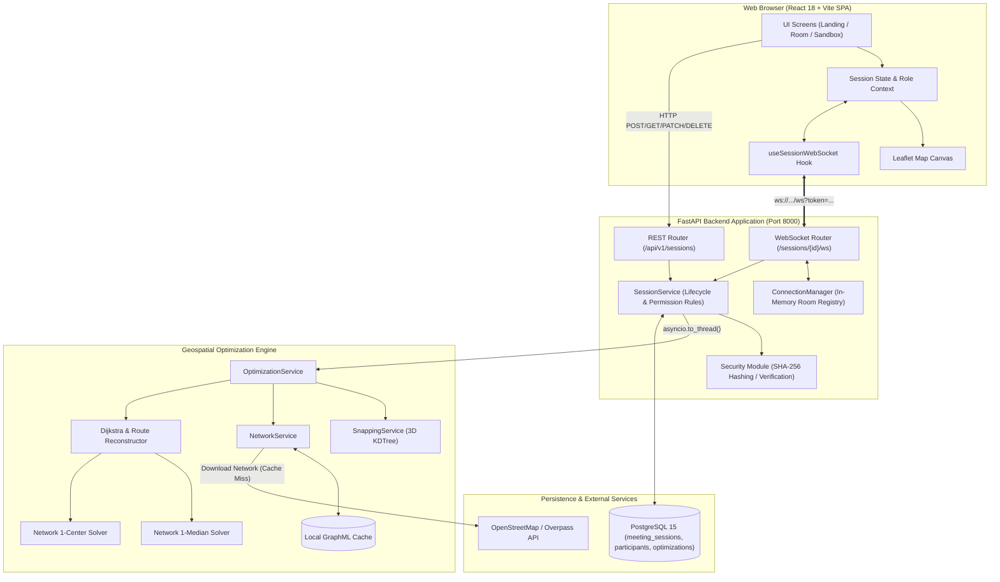
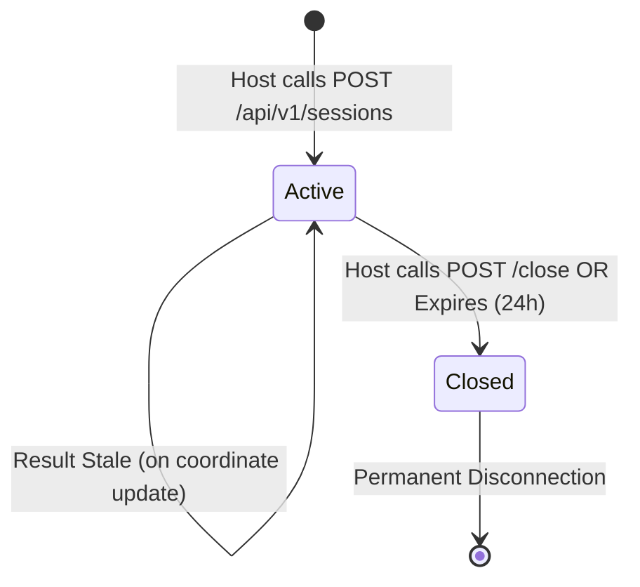
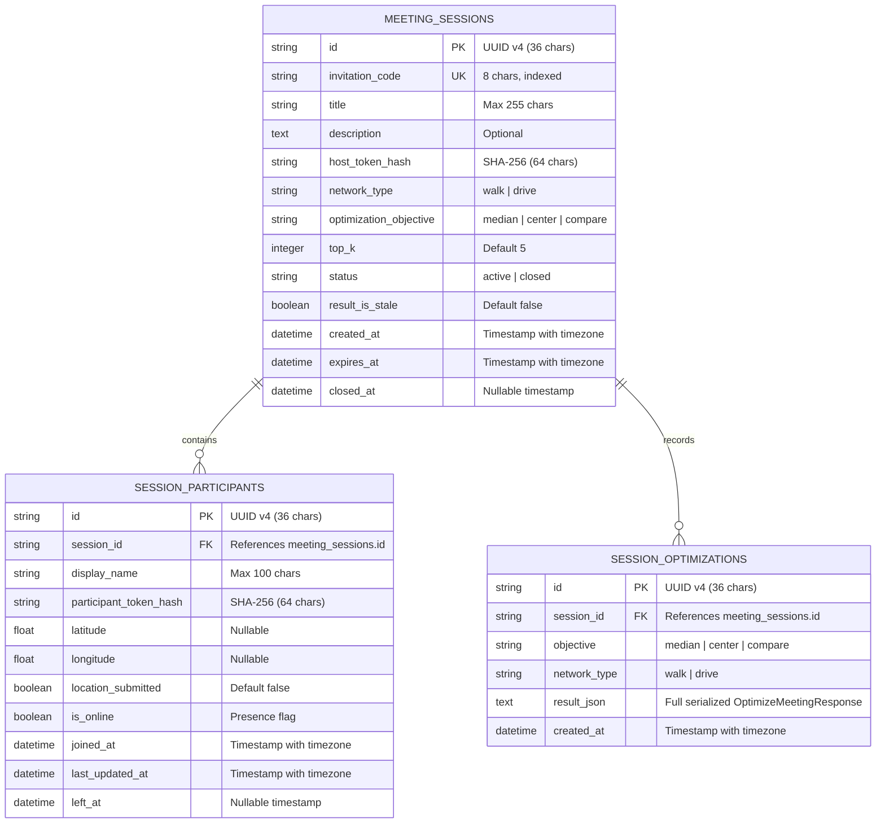

# MeetPoint — Comprehensive System Architecture Audit

**Project:** MeetPoint  
**Version:** v0.4.0 (Collaborative Sessions)  
**Date of Audit:** November 14, 2026  
**Auditor:** DeepMind Engineering Assessment Agent  
**Active Branch:** `feature/multi-user-sessions` (Commit `94444a5`)  
**Status:** Pre-Production Architectural Review  

---

## 1. Executive Summary

### 1.1 Product Definition & Core Mission
**MeetPoint** is an end-to-end geospatial optimization and collaborative real-time web application. Its core mission is to find the mathematically optimal meeting location for $N$ geographically distributed participants using actual, traversable road and pedestrian networks—rather than naive straight-line (Euclidean/Haversine) approximations.

The application operates without user registration or persistent accounts. Instead, meeting hosts generate transient, collaborative rooms secured by high-entropy cryptographic tokens. Participants join via an 8-character invitation code, review an explicit location-privacy disclosure, and optionally submit their coordinates. The engine evaluates candidate road network intersections, executes single-source Dijkstra calculations, determines optimal locations under selected facility location objectives, reconstructs traversable route polylines, and broadcasts synchronized results to all room members via WebSockets.

### 1.2 Mathematical Optimization Objectives
MeetPoint formalizes the group meeting problem as a discrete facility location problem constrained to the vertices $V$ of a directed road graph $G = (V, E, w)$:

1. **Network 1-Median (Min-Sum Travel Distance)**:
   $$\min_{c \in C} \sum_{i=1}^{N} d_G(p_i, c)$$
   Minimizes the cumulative travel distance traversed by all participants. This represents the utilitarian social welfare optimum.
2. **Network 1-Center (Minimax Travel Distance / Min-Max Journey)**:
   $$\min_{c \in C} \max_{i \in \{1, \dots, N\}} d_G(p_i, c)$$
   Minimizes the longest individual journey among all participants. This represents the egalitarian fairness optimum.
3. **Comparative Evaluation Mode**:
   Evaluates both 1-Median and 1-Center across the same candidate set, computes difference metrics ($\Delta \text{aggregate}$, $\Delta \text{maximum}$), and provides trade-off insights for the host.
4. **Top-$K$ Candidate Ranking**:
   Ranks the top $K$ alternative intersections ($K \in [1, 20]$), enforcing spatial deduplication so geographically adjacent nodes do not crowd the alternative recommendations.

### 1.3 Development Maturity & Quality Assessment
The codebase has evolved through four discrete milestones:
- **Phase 1**: Core Geospatial Engine (OSMnx ingestion, 3D KDTree snapping, Dijkstra shortest paths, Network 1-Median solver).
- **Phase 2**: Advanced Optimization & Route Reconstruction (Pedestrian `walk` mode default, Network 1-Center solver, comparative analysis, Top-$K$ ranking, polyline route reconstruction).
- **Phase 3**: Interactive Frontend & API Integration (React, Vite, TypeScript, Tailwind CSS, React Leaflet).
- **Phase 4**: Multi-User Sessions & Real-Time Collaboration (PostgreSQL persistence, SQLAlchemy 2.x async ORM, Alembic migrations, token security, FastAPI WebSockets, live room synchronization, stale-result invalidation).

**Overall Architectural Quality:** **High (B+)**.
The codebase exhibits a clean separation of concerns: mathematical algorithms are pure functions isolated from FastAPI web concerns, spatial indexing is abstracted via KDTree projections, database models adhere to SQLAlchemy 2.0 mapped-column declarations, and the frontend separates stateful room hooks from UI layout components.

### 1.4 Major Strengths
- **Rigorous Network Routing**: Does not approximate distances using straight-line geometry; routes strictly respect one-way directions, pedestrian access barriers, and segment length metrics in metres.
- **Privacy-Preserving Architecture**: Zero background GPS tracking. Locations are shared only upon explicit participant initiation and can be updated or withdrawn at will.
- **Stateless Authentication**: High-entropy tokens (`secrets.token_urlsafe(32)`) hashed with SHA-256 in PostgreSQL eliminate the security overhead and liability of user passwords and JWT key rotation.
- **Robust Automated Verification**: 68 automated unit and integration tests passing in under 3 seconds with zero external network dependencies (using synthetic graphs and mocked Overpass adapters).
- **Reactive UX**: Clean stale-result detection flags when participants alter coordinates after optimization, preventing stale routes from misleading groups.

### 1.5 Major Risks & Vulnerabilities
- **Single-Process WebSocket Manager**: Active WebSocket connections are tracked in an in-memory dictionary. Multiple backend container replicas cannot communicate without an external message bus (e.g., PostgreSQL `LISTEN/NOTIFY`).
- **Permissive CORS Configuration**: `main.py` configures `allow_origins=["*"]` with `allow_credentials=True`, presenting a cross-origin security vulnerability for production.
- **Absence of API Rate Limiting**: No rate-limiting safeguards exist on session creation, invitation lookup, or optimization endpoints, exposing the system to denial-of-service or Overpass API quota exhaustion.
- **Unbounded Overpass Query Risk**: Bounding boxes computed from distant participants could trigger massive OSM downloads that exceed container memory limits or Overpass query timeouts.

---

## 2. Complete Technology Stack

| Layer | Technology | Declared Version | Actual Runtime Version | Usage in MeetPoint |
|---|---|---|---|---|
| **Runtime** | Python | `>=3.12` | `3.12.15` | Core backend execution environment |
| **API Framework** | FastAPI | `>=0.115.0` | `0.162.6` | Asynchronous REST routing, OpenAPI schema generation, WebSocket protocol handling |
| **ASGI Server** | Uvicorn | `[standard]>=0.30.0` | `0.54.0` | High-performance ASGI web server with `uvloop` (`0.23.0`) and `httptools` (`0.9.0`) |
| **Data Validation** | Pydantic / Core | `>=2.0.0` | `2.14.3` / `2.50.4` | Strict schema validation, coordinate bounds checking, DTO serialization |
| **Settings** | Pydantic-Settings | `>=2.0.0` | `2.16.3` | Environment configuration with `MEETPOINT_` prefixing |
| **Database ORM** | SQLAlchemy | `>=2.0.0` | `2.1.8` | Declarative 2.x mapped classes, async session management |
| **Async DB Driver** | asyncpg | `>=0.29.0` | `0.32.0` | High-throughput asynchronous PostgreSQL client driver |
| **Sync DB Driver** | psycopg2-binary | `>=2.9.0` | `2.9.13` | Synchronous PostgreSQL driver utilized by Alembic migration runner |
| **Async Coroutine Bridge**| greenlet | `>=3.0.0` | `3.5.6` | Required bridge for SQLAlchemy asyncio ORM context switching |
| **Database Migrations** | Alembic | `>=1.13.0` | `1.20.1` | Transactional DDL schema versioning and migration generation |
| **Database Engine** | PostgreSQL | `15+` | `15.13 (Docker)` | Relational data persistence for sessions, participants, and optimization history |
| **OSM Topology** | OSMnx | `>=2.0.0` | `2.1.1` | Overpass API ingestion, boundary querying, GraphML export/import |
| **Graph Modeling** | NetworkX | `>=3.0` | `3.7` | MultiDiGraph and DiGraph structures, Dijkstra shortest-path algorithms |
| **Spatial Indexing** | SciPy | `>=1.13.0` | `1.18.1` | `scipy.spatial.KDTree` for 3D Cartesian spherical coordinate snapping |
| **Vector Math** | NumPy | `>=1.26.0` | `2.5.4` | Vectorized coordinate transformations and haversine calculations |
| **Geospatial Processing**| Shapely / GeoPandas | `>=2.0.0` / `>=1.0.0`| `2.2.0` / `1.2.0` | Coordinate geometry, planar bounding box formatting, OSM spatial integration |
| **Testing** | Pytest / AnyIO | `>=8.0.0` | `9.2.0` / `4.16.0` | Test runner, fixtures, and asynchronous WebSocket testing harnesses |
| **Frontend Runtime**| Node.js / npm | `>=20.0.0` | `v20.18.0` / `10.8.2` | Frontend build and package execution environment |
| **Frontend Framework**| React / React-DOM | `^18.3.1` | `18.3.1` | Reactive component tree, hooks state management, UI rendering |
| **Build Tool** | Vite | `^5.4.11` | `5.4.21` | ES module bundler, fast HMR development server, production asset optimizer |
| **Language** | TypeScript | `^5.6.3` | `5.6.3` | Static typing, interface definitions for geometry, sessions, and WebSocket events |
| **Styling** | Tailwind CSS | `^3.4.15` | `3.4.15` | Utility-first responsive CSS styling with dark slate theme |
| **Mapping Engine** | Leaflet / React Leaflet | `^1.9.4` / `^4.2.1` | `1.9.4` / `4.2.1` | Interactive tile mapping, custom DivIcons, polylines, and bounds fitting |
| **Icons** | Lucide React | `^0.460.0` | `0.460.0` | SVG icons for interface navigation, presence status, and actions |

---

## 3. System Architecture

### 3.1 Component Interaction Overview
MeetPoint follows a clean client-server architecture with an asynchronous event bridge. The frontend is a Single Page Application (SPA) communicating over standard HTTP REST for command actions (create session, join, update settings, trigger optimization) and WebSockets for duplex event synchronization (presence updates, coordinate streaming, live calculation results).



### 3.2 Runtime Execution Flow
1. **Creation**: Host initiates `POST /api/v1/sessions`. `SessionService` generates an 8-character invitation code and a 32-byte URL-safe token. The token is hashed via SHA-256 and stored in `meeting_sessions.host_token_hash`. The raw token is returned to the host.
2. **Joining**: Participant initiates `POST /api/v1/sessions/{code}/join`. A participant record is inserted with a hashed participant token.
3. **WebSocket Connection**: Both clients open `WS /api/v1/sessions/{session_id}/ws?token={token}`. The endpoint verifies the token against stored hashes. Upon authentication, `ConnectionManager` registers the socket in the room pool and sends a complete `session_snapshot`.
4. **Coordinate Submission**: Participant calls `POST /api/v1/sessions/{session_id}/location`. Coordinates are written to PostgreSQL. `SessionService` dispatches a `participant_updated` event through `ConnectionManager.broadcast()`.
5. **Optimization**: Host initiates `POST /api/v1/sessions/{session_id}/optimize`. The service verifies that $\ge 2$ participants have coordinates, broadcasts `optimization_started`, and delegates execution to `OptimizationService` using `asyncio.to_thread()`.
6. **Result Broadcast**: Upon calculation, results are stored in `session_optimizations`, `result_is_stale` is reset to `False`, and `optimization_completed` is broadcast to all connected room members.

---

## 4. Geospatial Optimization Engine

### 4.1 Ingestion & Graph Construction
- **Network Acquisition**: Ingests directed road networks using `osmnx.graph_from_bbox()`. The bounding box is computed dynamically by enveloping participant coordinates with a configurable padding ratio (default 20%, minimum 0.015° ~ 1.65 km).
- **Network Modes**:
  - `walk`: OpenStreetMap pedestrian paths, footways, sidewalks, pedestrianized streets, and paths. This is the application default.
  - `drive`: Car-traversable roads strictly respecting one-way restrictions (`oneway=True`).
- **Graph Normalization**: Converted into a NetworkX `MultiDiGraph`. The sanitization pipeline (`_validate_and_sanitize_graph`) validates that all nodes contain floating-point `x` (longitude) and `y` (latitude) attributes and ensures all edges contain a numeric `length` in metres computed via the great-circle Haversine formula if missing.
- **Multi-Edge Resolution**: Converted to a simple `nx.DiGraph` using `to_simple_digraph()`, which deterministically retains the minimum length edge between any directed pair $(u, v)$, eliminating parallel multigraph traversal overhead.
- **Disk Caching**: Network graphs are serialized to local GraphML files keyed by `osm_{network_type}_{min_lat}_{min_lon}_{max_lat}_{max_lon}.graphml`. If present on disk or in the in-memory cache dictionary, disk/network acquisition is bypassed.

### 4.2 Coordinate Snapping Pipeline
- **3D Spherical Coordinate Transformation**: Rather than using planar 2D Euclidean snapping (which suffers from severe longitude convergence distortion at higher latitudes), `GraphSpatialIndex` converts WGS84 degrees into 3D Cartesian coordinates on a sphere of radius $R = 6,371,000 \text{ m}$:
  $$X = R \cos(\phi) \cos(\lambda), \quad Y = R \cos(\phi) \sin(\lambda), \quad Z = R \sin(\phi)$$
- **SciPy KDTree Query**: Nearest neighbor lookup executes in $O(\log |V|)$ time using `scipy.spatial.KDTree`.
- **Chord-to-Arc Conversion**: The 3D Euclidean chord distance $d_{\text{chord}}$ returned by the KDTree is translated back into true great-circle surface arc distance in metres:
  $$d_{\text{arc}} = 2 R \arcsin\left(\frac{d_{\text{chord}}}{2 R}\right)$$
- **Snapping Threshold**: Snapping distance is validated against `MAX_SNAP_DISTANCE_M` (default: 10,000 metres). Exceeding this raises a `ParticipantSnappingError`.

### 4.3 Dijkstra Engine & Shortest Paths
- **Algorithm**: Executes NetworkX `single_source_dijkstra` utilizing Fibonacci/binary heaps with edge weight `length` (in metres).
- **Complexity**: For $N$ participants and graph $G = (V, E)$, Dijkstra shortest paths are calculated from each participant's snapped node to all reachable nodes:
  $$\mathcal{O}(N \cdot (|E| + |V| \log |V|))$$
- **Co-Located Snapping Cache**: If multiple participants snap to the exact same graph intersection node, `compute_all_participant_paths_and_distances` caches the Dijkstra result map, avoiding redundant graph traversals.

### 4.4 Facility Location Solvers

#### Network 1-Median Solver (`one_median.py`)
- **Objective**: Minimizes cumulative distance:
  $$\min_{c \in C} \sum_{i=1}^{N} d_G(p_i, c)$$
- **Candidate Eligibility**: $C = \bigcap_{i=1}^{N} \text{Reachable}(p_i)$. A candidate node MUST be reachable from all $N$ participants along directed edges. If $C = \emptyset$, a `DisconnectedNetworkError` is raised.
- **Deterministic Two-Level Tie-Breaking**:
  1. *Primary*: Lowest aggregate distance $\sum d(p_i, c)$.
  2. *First Tie-Break*: Minimax fairness (lowest $\max_i d(p_i, c)$).
  3. *Final Tie-Break*: Deterministic string comparison of node IDs.

#### Network 1-Center Solver (`one_center.py`)
- **Objective**: Minimizes the maximum individual travel distance:
  $$\min_{c \in C} \max_{i \in \{1, \dots, N\}} d_G(p_i, c)$$
- **Candidate Eligibility**: Identical common reachability requirement.
- **Deterministic Two-Level Tie-Breaking**:
  1. *Primary*: Lowest maximum individual distance $\max_i d(p_i, c)$.
  2. *First Tie-Break*: Lowest aggregate distance $\sum d(p_i, c)$.
  3. *Final Tie-Break*: Deterministic string comparison of node IDs.

#### Top-$K$ Alternative Recommendations
- Evaluates and sorts all eligible candidates in $O(|C| \log |C|)$ time.
- Employs coordinate deduplication rounded to $10^{-6}$ degrees ($\sim 0.11 \text{ m}$ precision), preventing multi-level intersection nodes from creating duplicate recommendations.

### 4.5 Route Reconstruction
- Retains predecessor node sequences from `single_source_dijkstra`.
- `reconstruct_route_coordinates()` translates the sequence $[u_1, u_2, \dots, u_m]$ into ordered GPS `Coordinate` objects for direct rendering as Leaflet `Polyline` paths.
- Provides segment counts and exact route distance metrics in metres.

### 4.6 Mathematical & Practical Limitations
1. **Vertex-Constrained Optimization**: Hakimi's Theorem (1964) proves that for the 1-Median problem on an undirected network, at least one optimal solution always lies on a graph vertex (intersection). However:
   - For directed graphs with one-way streets, Hakimi's vertex property does not strictly hold.
   - For the 1-Center problem, the true global optimum may lie along an intermediate point on an edge between two vertices.
   *Assessment*: MeetPoint restricts candidates to graph vertices ($V$). This provides an exceptionally close approximation that is computationally tractable and corresponds to actual street intersections where groups can conveniently meet.
2. **Network Disconnection in Directed Graphs**: In directed vehicle networks, one-way streets can easily prevent mutual reachability, resulting in $C = \emptyset$. Pedestrian networks (`walk`) are overwhelmingly bidirectional, making `walk` vastly more reliable for group meeting calculations.

---

## 5. Multi-User Session Architecture

### 5.1 Session Lifecycle State Machine



### 5.2 Token & Role Security Model
The system distinguishes three roles enforced entirely at the backend layer:
- **HOST**: Creator of the session. Authenticated via `host_token`. Authorized to update settings, trigger optimization, remove participants, and close the session.
- **PARTICIPANT**: Member who joined via invitation code. Authenticated via `participant_token`. Authorized to submit coordinates, update coordinates, withdraw coordinates, and leave the session.
- **VIEWER**: Unauthenticated or unrecognized connection. Prohibited from WebSocket access and modification endpoints.

**Token Hashing Implementation**:
- Tokens are 32-byte URL-safe strings: `secrets.token_urlsafe(32)`.
- Stored exclusively as SHA-256 hex strings in PostgreSQL:
  ```python
  def hash_token(token: str) -> str:
      return hashlib.sha256(token.encode("utf-8")).hexdigest()
  ```
- Comparison is constant-time via `hmac.compare_digest()`, preventing timing side-channel attacks.

### 5.3 Real-Time WebSocket Synchronization Protocol
- **Endpoint**: `WS /api/v1/sessions/{session_id}/ws?token={token}`
- **Authentication**: Validated during socket handshake. Invalid tokens trigger immediate closure with close code `4003` (Forbidden); non-existent sessions trigger close code `4004` (Not Found).
- **Snapshot Delivery**: Upon connection, the socket receives a complete `session_snapshot` containing current session settings, participant presence, and the latest optimization result if available.
- **Broadcast Events**:
  - `participant_joined`: Emitted when new member joins.
  - `participant_updated`: Emitted when coordinates change or connection goes online/offline.
  - `participant_removed` / `participant_left`: Emitted when participant leaves or host expels them.
  - `settings_updated`: Emitted when host updates title, mode, objective, or top-$k$.
  - `optimization_started`: Emitted when host triggers calculation.
  - `optimization_completed`: Emitted with full route geometry and ranked candidates.
  - `optimization_failed`: Emitted if graph calculation fails.
  - `result_stale`: Emitted when any participant modifies or withdraws coordinates after optimization.
  - `session_closed`: Emitted when host terminates the session.
- **Heartbeat**: Frontend transmits `{"type": "ping"}` every 25 seconds; backend replies with `{"type": "pong"}` to maintain connection liveness across stateful proxies.

---

## 6. Database Architecture

### 6.1 Entity-Relationship Model



### 6.2 Structural Audit & Constraints
1. **Primary & Foreign Keys**: Primary keys use standard 36-character UUID strings (`uuid.uuid4()`), ensuring database portability between PostgreSQL and SQLite test harnesses. Foreign keys define `ondelete="CASCADE"`, guaranteeing that deleting a session automatically purges its participants and optimization history.
2. **Indexing**:
   - `ix_meeting_sessions_invitation_code`: Unique B-Tree index on `invitation_code` enabling $O(1)$ lookups for room entry.
   - `ix_meeting_sessions_id`: Primary index on session UUID.
   - `ix_session_participants_session_id`: Index on foreign key for performant participant joins.
   - `ix_session_optimizations_session_id`: Index on foreign key for fast result retrieval.
3. **Data Types**: All timestamps declare `DateTime(timezone=True)` with server defaults (`func.now()`). Geographical coordinates are stored as standard 64-bit IEEE floating-point numbers (`Float`). Optimization results are stored as text-serialized JSON (`result_json`), providing schema flexibility without requiring Postgres-specific `JSONB` extensions that would break test portability.
4. **Connection Management**:
   - Asynchronous engine declares `poolclass=NullPool` in `backend/app/db/session.py`. This prevents `asyncpg` connection pool instances from leaking across different event loops during concurrent requests and pytest executions.

---

## 7. API Documentation & Inventory

### 7.1 REST API Endpoints (`/api/v1`)

| Method | Endpoint | Purpose | Auth / Role | Key Request Fields | Key Response Fields | Error Codes |
|---|---|---|---|---|---|---|
| `GET` | `/health` | Service health check | None | None | `status`, `service`, `version` | 500 |
| `POST` | `/meeting/optimize` | Phase 3 single-user optimization | None | `participants`, `network_type`, `objective`, `top_k` | `optimal_location`, `individual_distances`, `candidates` | 400, 422, 500 |
| `GET` | `/network/info` | Cached graph statistics | None | None | `cached_networks_count`, `cached_files` | 500 |
| `POST` | `/sessions` | Create collaborative session | None | `title`, `description`, `network_type`, `objective`, `top_k` | `session_id`, `invitation_code`, `host_token` | 422, 500 |
| `GET` | `/sessions/{code}` | Retrieve public session info | None | `invitation_code` (path) | `title`, `status`, `participants_count`, `is_expired` | 404, 500 |
| `POST` | `/sessions/{code}/join` | Join session as participant | None | `display_name`, `latitude` (opt), `longitude` (opt) | `participant_id`, `participant_token`, `location_submitted` | 400, 404, 410, 422 |
| `POST` | `/sessions/{id}/location`| Submit or update coordinates | Participant | `latitude`, `longitude`, `token` (body/header) | `participant_id`, `location_submitted`, `result_is_stale` | 400, 401, 403, 404, 422 |
| `DELETE`| `/sessions/{id}/location`| Withdraw participant location | Participant | `X-Session-Token` (header) | `participant_id`, `location_submitted: false` | 400, 401, 403, 404 |
| `POST` | `/sessions/{id}/optimize`| Run group optimization | Host | `X-Session-Token` (header) | Full `OptimizeMeetingResponse` JSON payload | 400, 401, 403, 404, 410, 500 |
| `GET` | `/sessions/{id}/results` | Fetch latest meeting results | None / Member | `session_id` (path) | `has_result`, `result_is_stale`, `result` | 404, 500 |
| `PATCH`| `/sessions/{id}/settings`| Update room configuration | Host | `title`, `network_type`, `objective`, `top_k` | Updated `SessionPublicResponse` | 400, 401, 403, 404, 422 |
| `DELETE`| `/sessions/{id}/participants/{p_id}`| Remove participant from room | Host | `X-Session-Token` (header) | `status: "success"` | 401, 403, 404 |
| `POST` | `/sessions/{id}/leave` | Voluntarily leave meeting | Participant | `X-Session-Token` (header) | `status: "success"` | 401, 403, 404 |
| `POST` | `/sessions/{id}/close` | Permanently terminate room | Host | `X-Session-Token` (header) | `status: "success"` | 401, 403, 404 |

### 7.2 WebSocket Endpoint
- **URL**: `/api/v1/sessions/{session_id}/ws?token={token}`
- **Handshake Protocol**: Authenticates query token against database. Rejects invalid credentials before accept.
- **Message Framing**: JSON text envelopes containing `{"type": "<event_name>", "data": { ... }}`.

---

## 8. Security Audit

### 8.1 Findings Classification Matrix

| Finding ID | Title | Severity | Impact | Mitigation / Status |
|---|---|---|---|---|
| **SEC-01** | Permissive CORS Configuration (`allow_origins=["*"]`) | **High** | Malicious third-party web domains can issue cross-origin requests to session APIs on behalf of users. | Must restrict `allow_origins` to authorized production domains in production configuration. |
| **SEC-02** | Absence of API Rate Limiting | **High** | Unauthenticated clients can flood `/sessions` or `/join`, exhausting database connections or triggering massive OSM downloads. | Implement IP-based and token-based rate limiting (e.g. SlowAPI or Cloudflare Rate Limiting rules). |
| **SEC-03** | WebSocket Token in Query String | **Medium** | Tokens in `?token=` parameters may appear in web server access logs and browser histories. | Configure production ingress to redact query strings from access logs; enforce strict TLS/WSS. |
| **SEC-04** | Room Enumeration Potential | **Low** | The 8-character invitation code alphabet ($32^8 \approx 1.1 \times 10^{12}$ combinations) is large, but without rate limiting, brute-force enumeration could identify active rooms. | Enforce rate limits on failed `/api/v1/sessions/{code}` lookups (e.g., maximum 5 failed attempts per minute per IP). |
| **SEC-05** | Token Plaintext Exposure | **Low** | Host and participant tokens are returned in initial creation/join response payloads and held in client memory/localStorage. | Secure: tokens are never stored in plaintext on the database (SHA-256 only) and never transmitted to other participants. |
| **SEC-06** | SQL Injection Resistance | **Informational** | All database interactions utilize SQLAlchemy 2.0 parameterized queries and ORM mappings. Zero raw SQL string interpolation. | **Verified Secure**. |
| **SEC-07** | Constant-Time Token Verification | **Informational** | Token verification uses `hmac.compare_digest()`, eliminating timing attack vulnerabilities. | **Verified Secure**. |
| **SEC-08** | Coordinate Privacy Safeguards | **Informational** | No continuous background geolocation tracking is implemented. Participants explicitly authorize one-time coordinate submissions. | **Verified Privacy-Conscious**. |

---

## 9. Performance & Scalability Analysis

### 9.1 Computational Bottlenecks
1. **Dijkstra Calculation on Urban Networks**:
   - For an urban bounding box (e.g. Central London, radius 3 km), $|V| \approx 5,000$ to $15,000$ nodes, $|E| \approx 10,000$ to $30,000$ edges.
   - Single-source Dijkstra takes approximately **10–25 ms** per participant.
   - For $N = 5$ participants, total Dijkstra computation is $\approx 50–125 \text{ ms}$.
   - For $N = 20$ participants, computation increases to $\approx 200–500 \text{ ms}$.
2. **CPU-Bound Asynchronous Offloading**:
   - MeetPoint uses `asyncio.to_thread(optimization_service.optimize_meeting_location, opt_request)`. This runs the CPU-bound Dijkstra and candidate scoring logic in a thread pool worker, preventing the FastAPI async event loop from freezing and ensuring concurrent WebSocket heartbeats and HTTP requests are not blocked.
3. **Graph Acquisition & Serialization Overhead**:
   - Overpass API downloads for new bounding boxes take **1.5–5.0 seconds** over the public internet.
   - Parsing and serializing GraphML from disk takes **80–250 ms** depending on file size.

### 9.2 Scalability Projections

```text
Concurrent Sessions | Estimated CPU Load | Estimated Memory | Projected Bottleneck
--------------------|--------------------|------------------|-----------------------------------------------
10 Active Sessions  | 5–15% (1 vCPU)     | 350–600 MB       | None; handled effortlessly by single instance.
100 Active Sessions | 40–80% (2–4 vCPU)  | 1.5–3.0 GB       | Memory usage from concurrent GraphML models;
                    |                    |                  | occasional Overpass API timeout spikes.
1,000 Active Sessions| Saturated         | 8–16 GB          | In-memory WebSocket manager cannot scale across
                    |                    |                  | multiple instances; Overpass rate limits hit.
```

- **10 Concurrent Sessions**: Easily accommodated within a single container (1 vCPU, 1 GB RAM). Memory cache easily fits graphs.
- **100 Concurrent Sessions**: In-memory connection manager handles $\approx 300–500$ concurrent WebSockets comfortably. Memory consumption will grow as distinct geographical regions are cached in memory. An LRU eviction policy for `_memory_cache` in `NetworkService` will be needed.
- **1,000 Concurrent Sessions**: Requires horizontal multi-container scaling. Because `ConnectionManager` is currently in-process memory, horizontal scaling will fail without an external pub/sub layer.

---

## 10. Cloudflare Deployment Compatibility

An evaluation of deploying MeetPoint to the modern Cloudflare ecosystem:

### 10.1 Cloudflare Pages (Frontend SPA)
- **Compatibility**: **100% Compatible**.
- **Assessment**: The Vite production build outputs static HTML, CSS, and JS (`dist/`). Can be deployed directly to Cloudflare Pages with zero server configuration.
- **Environment Configuration**: Set `VITE_API_BASE_URL` in Cloudflare Pages build settings to point to the backend domain.

### 10.2 Cloudflare Containers (FastAPI Backend)
- **Compatibility**: **High (with standard container image)**.
- **Native C-Extensions Assessment**:
  - OSMnx, GeoPandas, Shapely, and PyProj rely on underlying C libraries (`libgeos-dev`, `libproj-dev`, `libgdal-dev`).
  - Standard pre-built wheels (`manylinux`) installed via `uv pip` bundles necessary shared libraries cleanly on Debian/Ubuntu/Alpine glibc bases.
- **Memory Requirements**: A container running MeetPoint should be provisioned with at least **1 GB to 2 GB RAM** to comfortably support OSMnx graph manipulation and SciPy spatial indexing.
- **Filesystem Persistence**: Containers have ephemeral filesystems. Any GraphML cached to local disk (`backend/cache/`) will be lost upon container restart.

### 10.3 Neon PostgreSQL (Database)
- **Compatibility**: **100% Compatible**.
- **Assessment**: Neon serverless Postgres supports standard PostgreSQL wire protocol. Works seamlessly with `asyncpg` and `psycopg2`.
- **Connection Configuration**: In Neon, configure `sslmode=require`. With serverless connection pooling, SQLAlchemy `NullPool` is ideal because it avoids maintaining idle connections against the pooler.

### 10.4 Cloudflare R2 Storage (Graph Caching)
- **Compatibility**: **Recommended for Persistence**.
- **Assessment**: Instead of ephemeral local disk storage for GraphML caches, `NetworkService` can be backed by Cloudflare R2 via `boto3`/S3-compatible API. This ensures graphs downloaded once are permanently retained across all container restarts and regions.

### 10.5 Cloudflare Proxy & WebSockets
- **Compatibility**: **Fully Supported**.
- **Assessment**: Cloudflare's edge proxy natively supports WebSocket upgrade requests with no additional configuration required beyond enabling WebSocket connections in the dashboard.
- **Timeouts**: The 100-second HTTP proxy timeout on Cloudflare free/pro tiers must be respected; long Overpass queries should have explicit 30-second timeouts.

---

## 11. Technical Debt & Prioritized Limitations

### 11.1 Must Fix Before Production
1. **Restrict CORS Origins** (`backend/app/main.py`): Replace `allow_origins=["*"]` with an environment-driven whitelist (`MEETPOINT_CORS_ORIGINS`).
2. **Environment Variable Database Injection**: Ensure production deployment strictly overrides `DATABASE_URL` and `SYNC_DATABASE_URL` via secure environment variables rather than falling back to local credentials.
3. **Database Connection Pool Configuration**: Ensure production uses appropriate pooling settings with `pool_pre_ping=True` and connection recycling when not using `NullPool`.
4. **API Rate Limiting**: Introduce rate limiting on `/api/v1/sessions` (creation) and `/api/v1/sessions/{code}/join` (joining) to prevent resource exhaustion.

### 11.2 Should Fix Before Public Launch
1. **Automated Session Reaper Job**: Expired sessions (`expires_at < now`) are currently only marked closed when accessed. Implement a lightweight periodic task (e.g. daily cron or Celery/asyncio background task) to purge expired sessions and associated route records.
2. **Network Memory Cache Eviction**: `NetworkService._memory_cache` currently grows monotonically. Add an LRU cache size limit (e.g. retain max 10 active graphs in RAM).
3. **Frontend Error Boundaries**: Wrap the React map and collaborative sidebar in a React Error Boundary to recover gracefully if a Leaflet layer throws an unhandled rendering error.

### 11.3 Can Defer Until Scaling
1. **Distributed WebSocket Pub/Sub**: Replace the single-process in-memory `ConnectionManager` with a distributed pub/sub mechanism (e.g. PostgreSQL `LISTEN/NOTIFY` or Redis) to support multi-container backend clusters.
2. **Cloudflare R2 Graph Caching**: Replace local disk GraphML storage with Cloudflare R2 object storage.

### 11.4 Optional Enhancements
1. **Continuous Edge-Level Optimization**: Expand candidate evaluation from discrete graph vertices to intermediate points along long street segments for slightly tighter 1-Center bounds.
2. **Exportable Navigation Routes**: Provide GeoJSON and GPX download buttons for participants to import their calculated paths into Google Maps or Apple Maps.

---

## 12. Recommended Roadmap

### Phase A — Production Readiness
*Objective: Harden security, package containers, and establish production infrastructure.*
1. **Security Hardening**:
   - Enforce environment-controlled CORS whitelist.
   - Configure SlowAPI rate limiting (e.g., 10 session creations per IP per hour).
   - Ensure all tokens are passed via authorization headers rather than query strings.
2. **Dockerization**:
   - Write a multi-stage `Dockerfile` based on `python:3.12-slim`.
   - Install minimal spatial dependencies and test container startup.
3. **Cloud Infrastructure Setup**:
   - Provision Neon PostgreSQL database and run `alembic upgrade head`.
   - Deploy React frontend to Cloudflare Pages.
   - Deploy backend container to Cloudflare Containers or Fly.io/Render.

### Phase B — Initial Public Launch
*Objective: Observability, operational safeguards, and user experience polish.*
1. **Observability & Error Tracking**:
   - Integrate Sentry or OpenTelemetry in FastAPI and React for error capture.
   - Set up structured JSON logging in production.
2. **Lifecycle Maintenance**:
   - Implement an automated database cleanup task for expired sessions older than 48 hours.
   - Add Overpass API fallback servers to guard against OpenStreetMap server downtime.
3. **Domain & SSL**:
   - Attach custom production domain with Cloudflare SSL/TLS proxying.

### Phase C — Scaling & High Availability
*Objective: Support high-volume traffic and multi-region deployment.*
1. **Multi-Instance WebSockets**:
   - Implement PostgreSQL `LISTEN/NOTIFY` pub/sub inside `ConnectionManager` so WebSocket events broadcast across multiple backend instances without adding Redis.
2. **Cloudflare R2 Persistent Graph Cache**:
   - Connect `NetworkService` to Cloudflare R2 for zero-local-disk persistent graph sharing across containers.
3. **Metropolitan Pre-Warming**:
   - Pre-download and cache pedestrian networks for top metropolitan areas (London, New York, Tokyo, Berlin, Paris) during build time.

---

## 13. Audit Sign-Off & Verification Metadata

- **Verification Hash:** `94444a5`
- **Verification Commands Executed:**
  - `PYTHONPATH=backend pytest backend/tests -v` -> **68 passed in 2.86s**
  - `npm run build` -> **Built in 2.17s (0 errors)**
  - `alembic check` -> **Consistent with models (No new operations detected)**
- **Audit File Location:** `docs/ARCHITECTURE_AUDIT.md` (Uncommitted, available for manual review)
